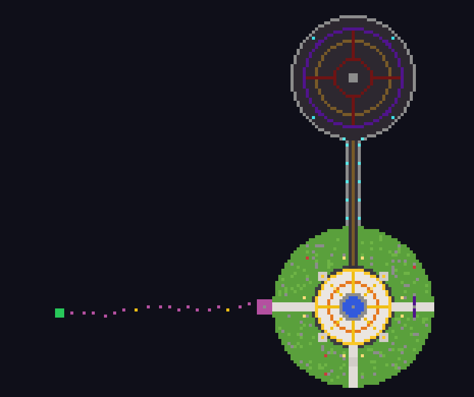

# ✦ DziobMc ✦ – paczka serwera Minecraft Java 1.21

**IP:** `Dziob.fun` • **Wersje:** 1.21 – 1.21.4 (Vanilla, Paper, Purpur, Spigot)

Gotowy serwer survival z własną mapą lobby, custom mobami, bossem, eventami, scoreboardem,
TAB-em, rangami, sklepem, kitami i komendami. Wszystko działa jako **datapack**, więc pluginy nie są potrzebne.
Opcjonalne konfiguracje pluginów TAB i LuckPerms są w paczce.



---

## 📦 Instalacja (5 minut)

1. Pobierz **`DziobMc-Serwer.zip`** i rozpakuj go.
2. Wrzuć do folderu `DziobMc-Serwer` plik **`server.jar`** w wersji 1.21–1.21.4
   (np. Paper z https://papermc.io lub Vanilla z minecraft.net).
3. Otwórz `eula.txt` i zmień `eula=false` na `eula=true`. Tym samym akceptujesz EULA Minecrafta.
4. Uruchom serwer: `start.bat` (Windows) albo `./start.sh` (Linux/Mac).
5. Mapa lobby **buduje się sama** przy pierwszym starcie (ok. 10 s po uruchomieniu).
6. Daj sobie OP-a w konsoli: `op TwójNick`, a potem rangę:
   `execute as TwójNick run function dziobmc:rangi/ustaw/wlasciciel`

> Masz już świat? Wrzuć `DziobMc-Datapack.zip` do `world/datapacks/`, wpisz `/reload`,
> a potem `/function dziobmc:mapa/zbuduj`. Lobby powstanie w niebie nad 0 150 0.

---

## 🗺️ Mapa (latająca wyspa w niebie, Y=150)

| Miejsce | Opis |
|---|---|
| **Plac główny** | fontanna z beaconem (pomarańczowy promień), animowany napis *DziobMc*, latarnie, wiśnie i dęby |
| **4 NPC** | ⛃ Sklep, ⚔ Kity, ✿ Nagroda, ? Pomoc. Kliknij prawym, żeby otworzyć menu |
| **Portal (wschód)** | wejdź, a przeniesie cię w losowe miejsce świata survival (RTP do 3000 kratek) |
| **Most → Arena (północ)** | arena bossa z ogniskami dusz i kręgami z płaczącego obsydianu |
| **Parkour (zachód)** | 18 tęczowych skoków; meta z szmaragdów daje 75 monet (co 10 min) |

Lobby jest strefą bezpieczną: gracze mają tam tryb przygody (nie da się niczego zniszczyć), wrogie moby
nie mają wstępu, a kto spadnie, wraca na spawn (z parkouru wraca na start parkouru).

---

## 👾 Custom moby

Część zwykłych mobów sama zamienia się w custom moby (12% szans, w czasie Krwawego Księżyca 60%).

| Mob | Bazowy | Specjalność | Monety |
|---|---|---|---|
| ⚔ Dziobak Wojownik | zombie | żelazna zbroja, przy niskim HP wpada w **szał** | 15 |
| ☄ Ognisty Dziob | zombie/husk | ognisty miecz, odporny na ogień, płonie | 20 |
| ➶ Mroczny Łucznik | szkielet | łuk Power III, czarna zbroja | 15 |
| ❄ Lodowy Strażnik | stray/szkielet | hełm z lodu, spowalnia graczy w pobliżu | 20 |
| ☣ Jadowity Pająk | pająk | większy, szybszy, zatruwa | 15 |
| ✸ Mini Kreeper | creeper | mały, szybki, krótki lont | 20 |
| ☠ Widmowy Rycerz | wither szkielet | netherytowy miecz, świeci przez ściany | 30 |
| ♛ **Król Dziobów** (BOSS) | husk x2.5 | 600 HP, fala uderzeniowa, pioruny, przywołuje sługi, szał przy 50% HP, totem | **1000** |

Każdy mob ma własny drop (loot table).

---

## 🎉 Eventy (co 20 minut gry, odliczanie na bossbarze)

| Event | Czas | Co się dzieje |
|---|---|---|
| 🌑 Krwawy Księżyc | 5 min | wieczna noc, custom moby spawnują się masowo wokół graczy |
| 🎁 Drop Party | 1 min | z nieba nad spawnem lecą diamenty, jabłka, księgi… |
| ♛ Król Dziobów | 10 min | boss na arenie; ostatni cios = 1000 monet |
| ⛃ Podwójne Monety | 10 min | wszystkie monety x2 |
| ⚔ Polowanie | 5 min | pierwszy, kto zabije 10 custom mobów, wygrywa 500 monet |
| 💰 Deszcz Monet | chwila | każdy online dostaje 100 monet |

---

## 📊 Scoreboard i TAB

* **Sidebar (z prawej):** DziobMc, wersja, liczba graczy online i łącznie, aktualny event, `Dziob.fun`
* **TAB:** rangi z kolorowymi prefiksami (posortowane od Właściciela do Gracza) i monety każdego gracza
* **Nad głową:** życie gracza ❤
* **Pasek akcji (HUD):** twoje monety ⛃ i zabite moby ⚔ (w czasie Polowania: postęp X/10)
* **Bossbar:** odliczanie do następnego eventu i pasek życia bossa

Nagłówka i stopki w TAB-ie nie da się ustawić samym datapackiem. Jeśli chcesz je mieć,
zainstaluj plugin **TAB** i wklej `plugins-konfiguracja/TAB-config-fragment.yml`.

---

## ⌨️ Komendy graczy

Każdy gracz może je wpisać bez OP-a albo kliknąć w menu na czacie.

| Komenda | Działanie |
|---|---|
| `/trigger pomoc` | menu ze wszystkimi komendami |
| `/trigger spawn` | teleport na spawn |
| `/trigger rtp` | losowy teleport w świat (co 1 min) |
| `/trigger warp` | warpy: spawn, arena, parkour |
| `/trigger kit` | kity: Start, VIP, MVP, Legenda |
| `/trigger sklep` | sklep za monety (diamenty, totem, Miecz Dzioba, elytra…) |
| `/trigger nagroda` | 50–150 monet + losowy przedmiot co godzinę |
| `/trigger staty` | twoje statystyki |
| `/trigger event` | aktualny/następny event |
| `/trigger rangi` | lista rang i bonusów |
| `/trigger discord` | linki Discord i strona |

**Monety zdobywasz:** za custom moby, eventy, parkour, nagrodę godzinową i +10 za każde 5 minut gry.

---

## 👑 Rangi

| Ranga | Bonusy |
|---|---|
| [WŁAŚCICIEL] [ADMIN] [MOD] [HELPER] | ekipa serwera, wszystkie kity |
| [YT] [LEGENDA] | +50% monet, wszystkie kity |
| [MVP] | +50% monet, kity VIP i MVP |
| [VIP] | +25% monet, kit VIP |
| [GRACZ] | kit Start |

Nadawanie rangi: `/execute as NICK run function dziobmc:rangi/ustaw/vip`
(dostępne: `wlasciciel admin moderator helper youtuber legenda mvp vip gracz`)

---

## 🛠️ Panel admina

`/function dziobmc:admin/panel` otwiera klikalne menu na czacie, w którym możesz:
* zbudować mapę od nowa,
* wystartować dowolny event albo przyspieszyć następny,
* przywołać dowolnego custom moba lub bossa,
* nadawać rangi,
* włączyć tryb budowania (creative, lobby nie wymusza trybu przygody).

Monety: `/scoreboard players add NICK dz.coins 500`

---

## ✏️ Jak zmienić paczkę

Paczkę generuje skrypt w Pythonie, więc łatwo ją przerobić:

```bash
python3 narzedzia/generuj.py
```

* `narzedzia/komendy.py`: sklep (ceny, przedmioty), kity, **link do Discorda** (`DISCORD = ...`)
* `narzedzia/moby.py`: custom moby, HP, dropy, monety
* `narzedzia/eventy.py`: eventy i ich czasy
* `narzedzia/mapa.py`: mapa lobby
* `narzedzia/rdzen.py`: rangi, scoreboard, lobby
* `narzedzia/serwer.py`: MOTD, server.properties, TAB, LuckPerms

Skrypt sprawdza poprawność (brakujące funkcje, JSON, nazwy scoreboardów) i tworzy oba ZIP-y od nowa.

---

## ⚠️ Ważne

* Obsługiwane wersje to **1.21 – 1.21.4**. Od 1.21.5 Mojang zmienił format NBT i tekstów, więc na nowszych wersjach paczka nie zadziała bez przeróbek.
* Link do Discorda to placeholder (`discord.gg/TWOJ-LINK`). Podmień go w `komendy.py` i `serwer.py`.
* Strona `https://dziob.fun` jest podpięta w menu, ale sama strona i sklep z rangami są po twojej stronie.
