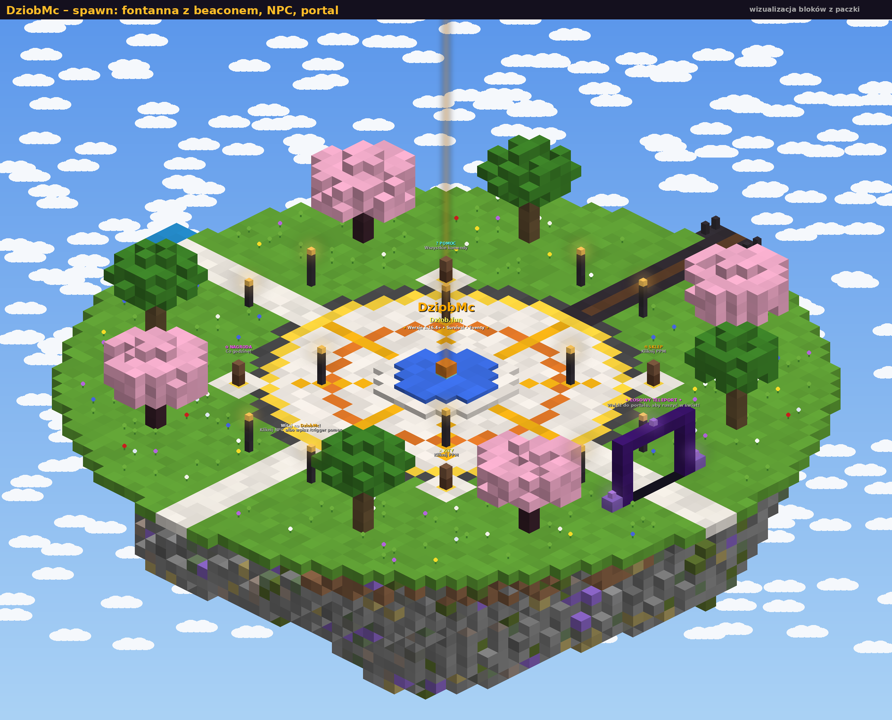
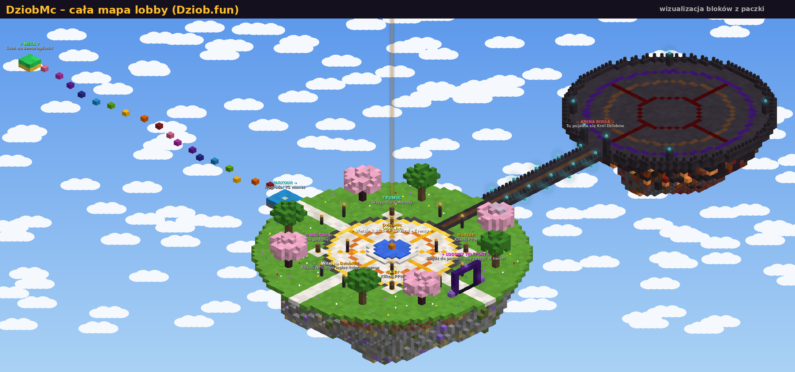
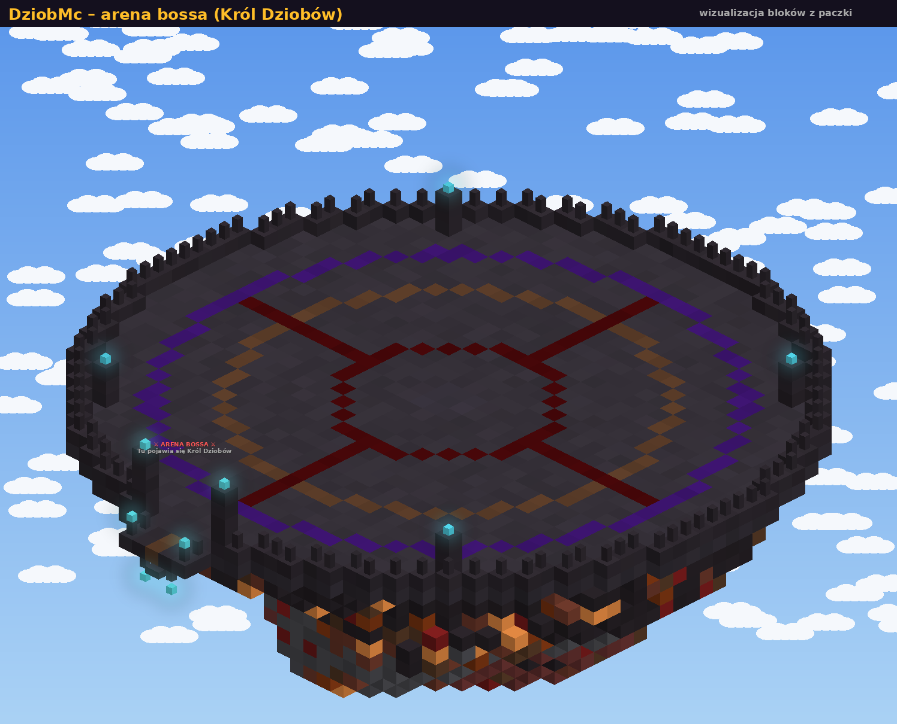
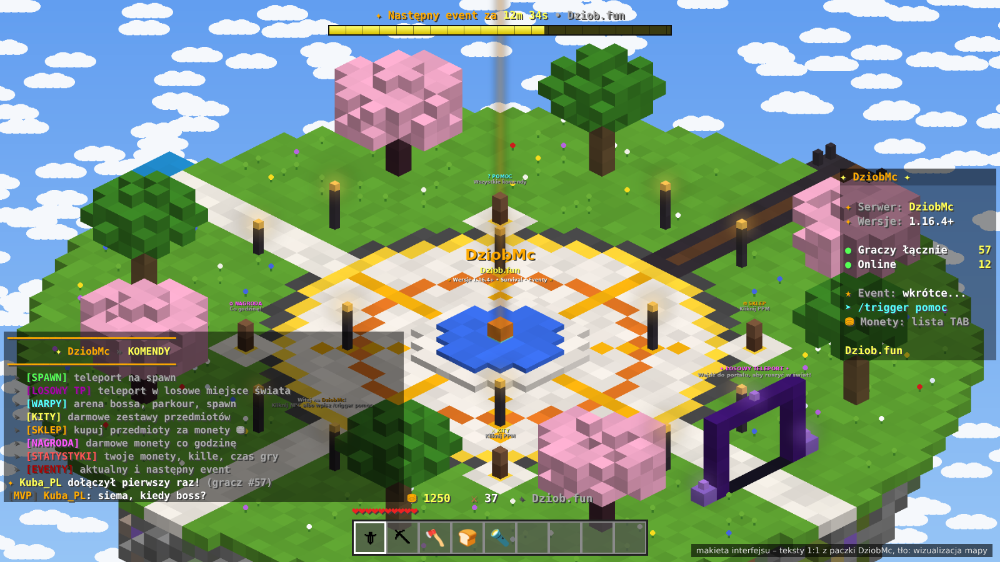
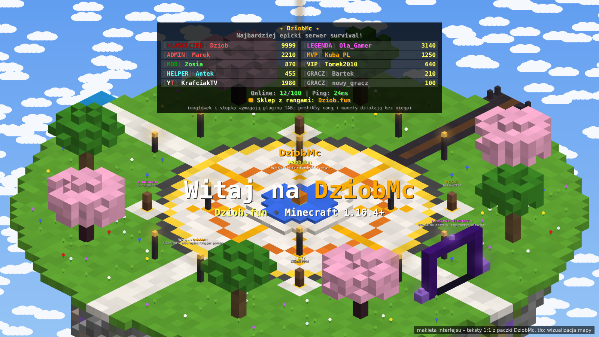

# ✦ DziobMc ✦ – paczka serwera Minecraft Java 1.21

**IP:** `Dziob.fun` • **Gracze mogą wchodzić z wersji 1.16.4 → najnowsza**

Gotowy serwer survival z własną mapą lobby, custom mobami, bossem, eventami, scoreboardem,
rangami, sklepem, kitami i komendami.

## 📸 Jak to wygląda

> Zrzuty 1–3 to wizualizacje 3D dokładnie tych bloków, które stawia paczka (nie zrzuty z gry).
> Zrzuty 4–5 to makiety interfejsu z tekstami 1:1 z paczki.







---

## 📁 Co gdzie jest (w tym repo)

```
DziobMc/
├── NA-HOSTING/                ← 👉 MASZ HOSTING? TO JEST DLA CIEBIE
├── POBIERZ/
│   ├── DziobMc-NaHosting.zip  ← to samo co NA-HOSTING/, w jednym pliku
│   ├── DziobMc-Serwer.zip     ← cały serwer na własny komputer/VPS
│   └── DziobMc-Datapack.zip   ← sama paczka
├── WLASNY-SERWER-na-komputerze/ ← rozpakowany DziobMc-Serwer.zip
├── narzedzia/                 ← generator (tylko do zmian)
└── INSTRUKCJA.md, podglad-mapy.png
```

## 🌍 Masz gotowy hosting? (serwer publiczny)

Pobierz **`POBIERZ/DziobMc-NaHosting.zip`**. Każdy folder w środku jest podpisany miejscem, do którego trzeba go wrzucić:

```
DziobMc-NaHosting/
├── 00 - PRZECZYTAJ MNIE.txt
├── 1 - WRZUC DO world-datapacks/          → zawartość do  world/datapacks/
│   └── DziobMc-Pack/                          (na hostingu: world/datapacks/DziobMc-Pack/pack.mcmeta)
├── 2 - WRZUC DO plugins/                  → linki do pluginów; pobrane .jar wrzuć do  plugins/
├── 3 - WRZUC DO glownego folderu serwera/ → server-icon.png do głównego folderu
├── 4 - SKOPIUJ DO server.properties/      → linijki do skopiowania (MOTD itd.)
└── 5 - OPCJONALNIE plugins-TAB i LuckPerms/
```

1. Wyłącz serwer, a w panelu wybierz **Paper 1.21.4**.
2. Wrzuć zawartość folderów 1–3 tam, gdzie mówi ich nazwa, i skopiuj ustawienia z folderu 4.
3. Pluginy z folderu 2: **ViaVersion** i **ViaBackwards** (gracze od 1.16.4 w górę) oraz **CoreProtect** (cofanie griefu).
4. Włącz serwer. Mapa lobby zbuduje się sama.
5. W konsoli: `op TwójNick` i `execute as TwójNick run function dziobmc:rangi/ustaw/wlasciciel`

**Bezpieczeństwo serwera publicznego:**
* `online-mode=true` wpuszcza tylko graczy premium i jest bezpieczne.
* `online-mode=false` (non-premium) pozwala każdemu wejść na twój nick. **Musisz** wtedy mieć plugin logowania **AuthMeReloaded**.
* Rangi VIP/MVP/… **nie dają OP-a** (dają prefiks, monety i kity), więc możesz je bezpiecznie rozdawać.
* Gracze używają tylko `/trigger …`. Tymi komendami nie da się nic zepsuć.
* Rób kopie zapasowe w panelu.
* Mapa buduje się w niebie (Y 125–165 wokół 0,0). Jeśli masz tam budowle, zostaną nadpisane.

## 📦 Własny serwer (komputer/VPS) – instalacja krok po kroku

Po rozpakowaniu `DziobMc-Serwer.zip`:

```
DziobMc-Serwer/
├── server.jar         ← [1] WRZUCASZ: Paper 1.21.4 (zmień nazwę na server.jar)
├── plugins/           ← [2] WRZUCASZ: ViaVersion.jar + ViaBackwards.jar
├── eula.txt           ← [3] ZMIENIASZ: eula=false → eula=true
├── start.bat          ← [4] Windows: kliknij 2x
├── start.sh           ←     Linux/Mac: ./start.sh
├── world/datapacks/   ← paczka DziobMc (już jest, nie ruszaj)
├── server.properties  ← gotowe (MOTD, port 25565)
├── server-icon.png    ← gotowe
├── dodatki-pluginy/   ← opcjonalnie: TAB i LuckPerms
└── GDZIE-CO-DAC.txt   ← ta sama instrukcja w pliku
```

1. Zainstaluj **Java 21**: https://adoptium.net
2. **[1]** Pobierz **Paper 1.21.4** z https://papermc.io/downloads/paper, zmień nazwę pliku na `server.jar` i wrzuć do folderu.
3. **[2]** Do folderu `plugins/` wrzuć:
   * **ViaVersion**: https://modrinth.com/plugin/viaversion (wpuszcza wersje NOWSZE niż 1.21.4)
   * **ViaBackwards**: https://modrinth.com/plugin/viabackwards (wpuszcza wersje STARSZE, aż do 1.16.4)
4. **[3]** W `eula.txt` zmień `eula=false` na `eula=true`. Tym samym akceptujesz EULA Minecrafta.
5. **[4]** Uruchom `start.bat`. Mapa lobby zbuduje się sama (ok. 10 s).
6. W konsoli serwera wpisz: `op TwójNick`, a potem
   `execute as TwójNick run function dziobmc:rangi/ustaw/wlasciciel`
7. Domena: w panelu domeny ustaw rekord **A** `Dziob.fun` → IP serwera.

### Dlaczego tak, a nie „paczka na każdą wersję”?

Komendy Minecrafta zmieniały się bardzo mocno między 1.16 a 1.21. W 1.16.4 nie ma w ogóle
hologramów, klikalnych NPC, komendy `random`, `return` ani `damage`. Jedna paczka nie może więc działać na serwerze
w każdej wersji. Tak robią duże serwery: **serwer stoi na jednej wersji (Paper 1.21.4)**,
a **ViaVersion + ViaBackwards** tłumaczą grę dla każdego gracza. Efekt:

* ✅ gracz z **1.16.4, 1.17, 1.18, 1.19, 1.20, 1.21, 1.21.10…** wchodzi bez problemu,
* ✅ gdy wyjdzie nowa wersja Minecrafta, wystarczy zaktualizować ViaVersion,
* ⚠️ gracze na starych wersjach (np. 1.16) mogą widzieć drobne różnice: numerki w scoreboardzie,
  inaczej wyglądające hologramy, a zamiast klikania NPC muszą użyć `/trigger sklep` itp.

> Masz już świat? Wrzuć zawartość `DziobMc-Datapack.zip` do `world/datapacks/DziobMc-Pack/`,
> wpisz `/reload`, a potem `/function dziobmc:mapa/zbuduj`.

---

## 🗺️ Mapa (latająca wyspa w niebie, Y=150)

| Miejsce | Opis |
|---|---|
| **Plac główny** | fontanna z beaconem (pomarańczowy promień), animowany napis *DziobMc*, latarnie, wiśnie i dęby |
| **4 NPC** | ⛃ Sklep, ⚔ Kity, ✿ Nagroda, ? Pomoc. Kliknij prawym, żeby otworzyć menu |
| **Portal (wschód)** | wejdź, a przeniesie cię w losowe miejsce świata survival (RTP do 3000 kratek) |
| **Most → Arena (północ)** | arena bossa z ogniskami dusz i kręgami z płaczącego obsydianu |
| **Parkour (zachód)** | 18 tęczowych skoków; meta z szmaragdów daje 75 monet (co 10 min) |

Lobby jest strefą bezpieczną: gracze mają tam tryb przygody (nie da się niczego zniszczyć), wrogie moby
nie mają wstępu, a kto spadnie, wraca na spawn (z parkouru wraca na start parkouru).

---

## 👾 Custom moby

Część zwykłych mobów sama zamienia się w custom moby (12% szans, w czasie Krwawego Księżyca 60%).

| Mob | Bazowy | Specjalność | Monety |
|---|---|---|---|
| ⚔ Dziobak Wojownik | zombie | żelazna zbroja, przy niskim HP wpada w **szał** | 15 |
| ☄ Ognisty Dziob | zombie/husk | ognisty miecz, odporny na ogień, płonie | 20 |
| ➶ Mroczny Łucznik | szkielet | łuk Power III, czarna zbroja | 15 |
| ❄ Lodowy Strażnik | stray/szkielet | hełm z lodu, spowalnia graczy w pobliżu | 20 |
| ☣ Jadowity Pająk | pająk | większy, szybszy, zatruwa | 15 |
| ✸ Mini Kreeper | creeper | mały, szybki, krótki lont | 20 |
| ☠ Widmowy Rycerz | wither szkielet | netherytowy miecz, świeci przez ściany | 30 |
| ♛ **Król Dziobów** (BOSS) | husk x2.5 | 600 HP, fala uderzeniowa, pioruny, przywołuje sługi, szał przy 50% HP, totem | **1000** |

Każdy mob ma własny drop (loot table).

---

## 🎉 Eventy (co 20 minut gry, odliczanie na bossbarze)

| Event | Czas | Co się dzieje |
|---|---|---|
| 🌑 Krwawy Księżyc | 5 min | wieczna noc, custom moby spawnują się masowo wokół graczy |
| 🎁 Drop Party | 1 min | z nieba nad spawnem lecą diamenty, jabłka, księgi… |
| ♛ Król Dziobów | 10 min | boss na arenie; ostatni cios = 1000 monet |
| ⛃ Podwójne Monety | 10 min | wszystkie monety x2 |
| ⚔ Polowanie | 5 min | pierwszy, kto zabije 10 custom mobów, wygrywa 500 monet |
| 💰 Deszcz Monet | chwila | każdy online dostaje 100 monet |

---

## 📊 Scoreboard i TAB

* **Sidebar (z prawej):** DziobMc, wersja, liczba graczy online i łącznie, aktualny event, `Dziob.fun`
* **TAB:** rangi z kolorowymi prefiksami (posortowane od Właściciela do Gracza) i monety każdego gracza
* **Nad głową:** życie gracza ❤
* **Pasek akcji (HUD):** twoje monety ⛃ i zabite moby ⚔ (w czasie Polowania: postęp X/10)
* **Bossbar:** odliczanie do następnego eventu i pasek życia bossa

Nagłówka i stopki w TAB-ie nie da się ustawić samym datapackiem. Jeśli chcesz je mieć,
zainstaluj plugin **TAB** i wklej `dodatki-pluginy/TAB-config-fragment.yml`.

---

## ⌨️ Komendy graczy

Każdy gracz może je wpisać bez OP-a albo kliknąć w menu na czacie.

| Komenda | Działanie |
|---|---|
| `/trigger pomoc` | menu ze wszystkimi komendami |
| `/trigger spawn` | teleport na spawn |
| `/trigger rtp` | losowy teleport w świat (co 1 min) |
| `/trigger warp` | warpy: spawn, arena, parkour |
| `/trigger kit` | kity: Start, VIP, MVP, Legenda |
| `/trigger sklep` | sklep za monety (diamenty, totem, Miecz Dzioba, elytra…) |
| `/trigger nagroda` | 50–150 monet + losowy przedmiot co godzinę |
| `/trigger staty` | twoje statystyki |
| `/trigger event` | aktualny/następny event |
| `/trigger rangi` | lista rang i bonusów |
| `/trigger discord` | linki Discord i strona |

**Monety zdobywasz:** za custom moby, eventy, parkour, nagrodę godzinową i +10 za każde 5 minut gry.

---

## 👑 Rangi

| Ranga | Bonusy |
|---|---|
| [WŁAŚCICIEL] [ADMIN] [MOD] [HELPER] | ekipa serwera, wszystkie kity |
| [YT] [LEGENDA] | +50% monet, wszystkie kity |
| [MVP] | +50% monet, kity VIP i MVP |
| [VIP] | +25% monet, kit VIP |
| [GRACZ] | kit Start |

Nadawanie rangi: `/execute as NICK run function dziobmc:rangi/ustaw/vip`
(dostępne: `wlasciciel admin moderator helper youtuber legenda mvp vip gracz`)

---

## 🛠️ Panel admina

`/function dziobmc:admin/panel` otwiera klikalne menu na czacie, w którym możesz:
* zbudować mapę od nowa,
* wystartować dowolny event albo przyspieszyć następny,
* przywołać dowolnego custom moba lub bossa,
* nadawać rangi,
* włączyć tryb budowania (creative, lobby nie wymusza trybu przygody).

Monety: `/scoreboard players add NICK dz.coins 500`

---

## ✏️ Jak zmienić paczkę

Paczkę generuje skrypt w Pythonie, więc łatwo ją przerobić:

```bash
python3 DziobMc/narzedzia/generuj.py
```

* `DziobMc/narzedzia/komendy.py`: sklep (ceny, przedmioty), kity, **link do Discorda** (`DISCORD = ...`)
* `DziobMc/narzedzia/moby.py`: custom moby, HP, dropy, monety
* `DziobMc/narzedzia/eventy.py`: eventy i ich czasy
* `DziobMc/narzedzia/mapa.py`: mapa lobby
* `DziobMc/narzedzia/rdzen.py`: rangi, scoreboard, lobby
* `DziobMc/narzedzia/serwer.py`: MOTD, server.properties, TAB, LuckPerms

Skrypt sprawdza poprawność (brakujące funkcje, JSON, nazwy scoreboardów) i tworzy oba ZIP-y od nowa.

---

## ⚠️ Ważne

* Sam **serwer** musi stać na **Paper 1.21.4** (paczka działa na serwerach 1.21–1.21.4). Gracze wchodzą z dowolnej wersji od 1.16.4 dzięki ViaVersion/ViaBackwards.
* Link do Discorda to placeholder (`discord.gg/TWOJ-LINK`). Podmień go w `komendy.py` i `serwer.py`.
* Strona `https://dziob.fun` jest podpięta w menu, ale sama strona i sklep z rangami są po twojej stronie.
